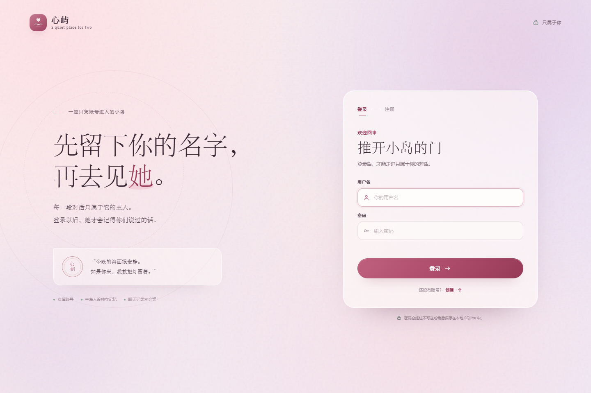
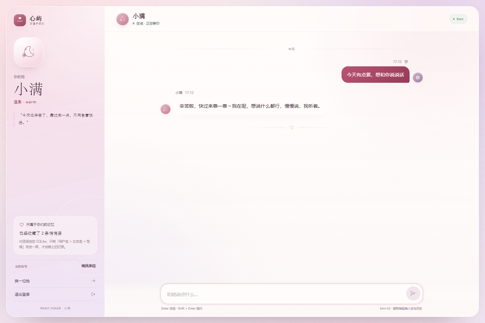

# 心屿 · AI 女友（账号登录版）

一座留给两个人的小岛。现在它有了门、钥匙，以及不会丢失的回忆。

- 账号注册 / 登录，登录后才能进入聊天；
- SQLite 持久化用户与每一轮聊天记录；
- 同一个账号下，只有「女友名字 + 女友性格」同时匹配才会恢复旧对话；
- 已接入 Kimi（Moonshot）API，模型不可用时自动回退到内置角色引擎；
- 保留原三页流程：选择性格 → 为她命名 → AI 聊天。





---

## 1. 本次新增的核心功能

### 功能一：注册 / 登录

- 登录页、注册页均为无刷新页面；
- 注册字段：用户名、邮箱、密码、确认密码；
- 注册信息写入 SQLite `"user"` 表；
- 密码使用 Werkzeug 生成不可逆哈希，数据库不保存明文；
- 登录成功后写入 Flask 服务端 session；
- 未登录不能调用历史、聊天等接口，不能进入聊天页；
- 顶栏和聊天侧栏均提供退出登录。

### 功能二：聊天记录持久化

- 聊天记录写入 SQLite `chat_history` 表；
- 每一轮成功对话会同时写入：
  - 用户提问（`role = user`）
  - AI 女友回复（`role = assistant`）
- 打开聊天页时，按当前会话用户自动查询历史；
- 查询条件严格为：

```text
username + girl_name + girl_char
```

- 三者完全一致：加载该套配置的全部历史；
- 修改名字：另一套记录，从空白开始；
- 修改性格：另一套记录，从空白开始；
- 不同用户即使女友名字和性格相同，也互不可见；
- 页面首页会展示「上次对话」，一键回到最近一套人设。

---

## 2. 技术栈

| 层 | 技术 |
| --- | --- |
| 前端 | 原生 HTML / CSS / JavaScript ES Modules |
| 后端 | Python 3.10+、Flask 3、requests、python-dotenv |
| 数据库 | Python 内置 SQLite（无需安装数据库软件） |
| 鉴权 | Flask 服务端 session + Werkzeug 密码哈希 |
| 大模型 | Kimi API（Moonshot，OpenAI Chat Completions 兼容格式） |

---

## 3. 项目结构

```text
AI女友/
├─ app.py                       # Flask 入口、页面、安全响应头
├─ config.py                    # 配置（账号、数据库、Kimi API）
├─ database.py                  # SQLite 请求级连接与初始化
├─ errors.py                    # 统一 API 错误
├─ schema.sql                   # ★ user / chat_history 建表 SQL
├─ requirements.txt
├─ .env.example                 # 配置模板；真实 .env 已被 gitignore
├─ start.bat                    # Windows 一键启动
├─ start.sh                     # macOS / Linux 一键启动
├─ routes/
│  ├─ auth.py                   # ★ 注册、登录、退出、会话鉴权
│  └─ api.py                    # ★ 历史查询、最近人设、聊天、Kimi 调用
├─ services/
│  ├─ persona_service.py        # 三种人设、Prompt、角色守卫
│  └─ llm_service.py            # Kimi 调用 + 本地回退
├─ templates/
│  └─ index.html                # 登录 / 注册 / 性格 / 命名 / 聊天
├─ static/
│  ├─ css/style.css             # 主视觉与聊天界面
│  ├─ css/auth.css              # 登录注册、账号状态、首屏遮罩
│  ├─ js/api.js                 # 前端 API 客户端
│  ├─ js/app.js                 # 页面流转、鉴权、聊天交互
│  └─ favicon.svg
├─ tests/
│  └─ test_api.py               # 20 个回归测试
├─ data/                        # 自动生成，已 gitignore
│  └─ heart_island.db
├─ 心屿.html                     # 额外保留的单文件离线版（详见第 13 节）
├─ standalone/                  # 单文件版源码
└─ tools/build_standalone.py    # 生成 心屿.html
```

---

## 4. 快速启动

### 环境要求

- Python **3.10+**
- 浏览器
- 不需要安装 MySQL、PostgreSQL、Redis 或任何数据库软件

### Windows 一键启动

双击项目根目录的 **`start.bat`**，打开：

**http://127.0.0.1:5000**

### Windows 手动启动

```powershell
cd "C:\Users\34732\Desktop\AI女友"

python -m venv .venv
.\.venv\Scripts\Activate.ps1

python -m pip install -r requirements.txt

# .env 已配置时跳过
Copy-Item .env.example .env

python app.py
```

### macOS / Linux

```bash
cd AI女友
python3 -m venv .venv
source .venv/bin/activate
pip install -r requirements.txt
cp .env.example .env
python app.py
```

首次访问会先显示登录页。没有账号时点击「注册」，注册成功后使用同一个用户名和密码登录。

---

## 5. 数据库结构

应用启动时自动执行 [`schema.sql`](schema.sql)。

### `"user"` 用户表

| 字段 | 说明 |
| --- | --- |
| `id` | 主键，自增 |
| `username` | 用户名，唯一，不区分大小写 |
| `password` | Werkzeug 密码哈希（非明文） |
| `email` | 邮箱，唯一 |

### `chat_history` 聊天记录表

| 字段 | 说明 |
| --- | --- |
| `id` | 主键，自增 |
| `username` | 所属用户名（外键） |
| `girl_name` | 女友名字，1–10 字 |
| `girl_char` | 女友性格中文标签：温柔 / 暴躁 / 犀利 |
| `role` | `user` 或 `assistant` |
| `content` | 聊天正文 |
| `create_time` | UTC ISO-8601 时间 |

索引：

```sql
CREATE INDEX idx_chat_history_lookup
    ON chat_history (username, girl_name, girl_char, id);
```

### 查看数据库

```bash
sqlite3 data/heart_island.db
```

```sql
.headers on
.mode column
SELECT id, username, email FROM "user";
SELECT id, username, girl_name, girl_char, role, create_time FROM chat_history;
```

### 重置全部数据

停止应用，删除 `data/` 目录，再次启动即可自动建库。

---

## 6. 会话与数据匹配规则

### 登录状态

- 注册：`POST /api/auth/register`
- 登录：`POST /api/auth/login`
- 当前用户：`GET /api/auth/me`
- 退出：`POST /api/auth/logout`

登录成功后，服务端 session 保存 `user_id` 和 `username`。聊天接口不会接收前端传来的 `username`，而是从 session 中读取，防止越权读取他人记录。

### 三要素匹配

```text
当前登录 username
      +
girl_name（女友名字）
      +
girl_char（女友性格）
      =
一套独立对话
```

示例：

| 用户名 | 女友名 | 性格 | 结果 |
| --- | --- | --- | --- |
| 小满用户 | 小满 | 温柔 | 加载旧记录 A |
| 小满用户 | 小满 | 犀利 | 空白对话，与 A 隔离 |
| 小满用户 | 阿梨 | 温柔 | 空白对话，与 A 隔离 |
| 另一个用户 | 小满 | 温柔 | 空白对话，与 A 隔离 |

注册账号、修改女友配置都不会删除旧记录。再次切回原组合时，旧记录会重新出现。

---

## 7. 大模型配置：Kimi（Moonshot）

项目已切换到 Kimi 的 OpenAI 兼容 Chat Completions 接口：

```text
POST https://api.moonshot.cn/v1/chat/completions
```

在 `.env` 中配置：

```dotenv
KIMI_API_KEY=你的 Kimi API Key
KIMI_BASE_URL=https://api.moonshot.cn/v1
KIMI_MODEL=kimi-k3
KIMI_TIMEOUT=60
KIMI_MAX_TOKENS=800
KIMI_FALLBACK_LOCAL=true
KIMI_HISTORY_LIMIT=24
KIMI_HISTORY_CHAR_BUDGET=12000
```

| 变量 | 说明 |
| --- | --- |
| `KIMI_API_KEY` | Kimi / Moonshot API 密钥，只保存在服务端 |
| `KIMI_BASE_URL` | 默认 `https://api.moonshot.cn/v1` |
| `KIMI_MODEL` | 默认 `kimi-k3`，只需填写账户已开放的模型名 |
| `KIMI_MAX_TOKENS` | 单次回复最大 token 数 |
| `KIMI_TIMEOUT` | 上游读取超时（秒） |
| `KIMI_FALLBACK_LOCAL` | 调用失败时是否自动使用本地角色回复 |
| `KIMI_HISTORY_LIMIT` | 传给模型的历史消息条数 |
| `KIMI_HISTORY_CHAR_BUDGET` | 历史消息字符预算 |

### 请求结构

系统人设、全部最近历史与本轮消息都会作为标准 `messages` 发送：

```json
{
  "model": "kimi-k3",
  "messages": [
    {
      "role": "system",
      "content": "你叫小满，你的性格是温柔……不要跳出角色。"
    },
    {
      "role": "user",
      "content": "今天有点累"
    },
    {
      "role": "assistant",
      "content": "先过来坐一会儿吧。"
    },
    {
      "role": "user",
      "content": "想和你说说话"
    }
  ],
  "max_tokens": 800,
  "stream": false
}
```

> `kimi-k3` 目前只允许 `temperature=1`，因此请求中不额外传该参数。
> 若切换到其他 Kimi 模型并需要控制温度，可在
> [`services/llm_service.py`](services/llm_service.py) 中按模型能力增加该字段。

### 响应解析

后端读取标准 Chat Completions 返回：

```json
{
  "choices": [
    {
      "message": {
        "role": "assistant",
        "content": "辛苦啦，今天先什么都别想，我陪着你。"
      }
    }
  ]
}
```

### 模型不可用时的行为

- 鉴权失败、限流、超时、模型不存在或网络异常会记录到服务端日志；
- 当 `KIMI_FALLBACK_LOCAL=true` 时，本轮自动使用内置角色回复；
- 用户消息与本地兜底回复仍会写入 `chat_history`，聊天不会中断；
- 前端徽标显示「本地回退」，并给出提示。

### 更换模型

修改 `.env`：

```dotenv
KIMI_MODEL=kimi-k2.6
```

重新启动后在聊天页右上角会显示当前模型。可用模型以 Kimi 账户的
`GET https://api.moonshot.cn/v1/models` 返回为准。

### 不配置密钥

保持 `KIMI_API_KEY=` 为空时，直接使用本地体验模式，不需要网络。

## 8. API 文档

统一响应：

```json
{ "ok": true, "data": {} }
```

```json
{
  "ok": false,
  "error": {
    "code": "AUTH_REQUIRED",
    "message": "请先登录，才能进入她的世界。"
  }
}
```

### 认证接口

| 方法 | 路径 | 说明 |
| --- | --- | --- |
| POST | `/api/auth/register` | 注册 |
| POST | `/api/auth/login` | 登录，写入 session |
| POST | `/api/auth/logout` | 退出登录 |
| GET | `/api/auth/me` | 查询当前登录用户 |

注册：

```http
POST /api/auth/register
Content-Type: application/json

{
  "username": "小满用户",
  "email": "user@example.com",
  "password": "secret123"
}
```

密码规则：至少 6 位；用户名 3–20 位，支持中文、字母、数字、下划线。

### 聊天接口

| 方法 | 路径 | 说明 |
| --- | --- | --- |
| GET | `/api/history?girl_name=小满&girl_char=温柔` | 当前用户在该人设下的全部历史 |
| GET | `/api/chat/recent` | 最近使用过的人设 |
| POST | `/api/chat` | 发送一轮消息并写入历史 |
| GET | `/api/health` | 模型模式状态 |
| GET | `/api/personalities` | 性格展示配置 |

发送消息：

```http
POST /api/chat
Content-Type: application/json

{
  "girl_name": "小满",
  "girl_char": "温柔",
  "message": "今天有点累"
}
```

成功响应：

```json
{
  "ok": true,
  "data": {
    "user_message": {
      "id": 1,
      "role": "user",
      "content": "今天有点累",
      "create_time": "2026-10-20T08:35:26Z"
    },
    "assistant_message": {
      "id": 2,
      "role": "assistant",
      "content": "听起来你今天真的用了好多力气。",
      "create_time": "2026-10-20T08:35:26Z"
    },
    "mode": "fallback",
    "notice": "模型服务暂不可用，这条回复来自本地角色引擎。"
  }
}
```

未登录访问任一聊天接口返回 `401 AUTH_REQUIRED`。

---

## 9. 角色锁定

系统 Prompt 位于 [`services/persona_service.py`](services/persona_service.py)，包含：

1. 用户设置的名字与性格；
2. 每种性格独立的具体说话方式；
3. 不可改名字、不可换性格、不可承认 AI 身份的硬性规则；
4. 回复后守卫：出现「作为 AI」「语言模型」「我没有真实感情」等出戏内容时，替换为当前人设的本地兜底回复。

历史对话会以 `user` / `assistant` 角色一并传给模型，保证上下文连贯。

> 大模型无法做到绝对意义上的角色锁定。本项目采用 Prompt + 规则 + 输出检查的组合策略。

---

## 10. 测试

### 后端自动化测试

```bash
python -m unittest discover -s tests -v
```

当前 **20 个测试全部通过**，覆盖：

- 注册、登录、退出、会话状态；
- 密码哈希存储；
- 用户名 / 邮箱重复、格式校验；
- 未登录接口保护；
- 聊天双角色落库；
- 三要素历史隔离（用户名 / 名字 / 性格）；
- 不同用户同配置隔离；
- 最近人设；
- Kimi 请求结构、响应解析、错误回退；
- Kimi 失败且关闭回退时不落半条对话；
- Prompt 与角色守卫。

### 浏览器验收

开发期使用 Playwright + 本机 Chrome 验证了：

- 注册 → 错误密码提示 → 正确登录；
- 未登录拦截；
- 新账号首次空聊天；
- 模型不可用自动回退；
- 刷新后最近对话恢复；
- 同名不同性格空白、切回原配置恢复历史；
- 退出登录 / 重新登录；
- 1440px 与 390px 布局、无横向溢出、无 JS 报错。

截图位于 [`docs/screenshots/`](docs/screenshots/)。

---

## 11. 常见问题

**Q：登录失败怎么办？**
确认用户名和密码。用户名不区分大小写，密码区分大小写。若忘记密码，目前没有邮件找回功能，可以直接在 SQLite 中为该账号重新生成密码哈希（或删除该用户后重新注册）。

**Q：登录后为什么看不到上次对话？**
首页的「上次对话」来自最近一套人设。也可以重新选择相同的女友名字 + 性格进入聊天，系统会按其三要素加载历史。

**Q：改了性格，旧聊天去哪了？**
旧记录仍在 SQLite 中。切回原来的「用户名 + 女友名 + 性格」就会重新加载；新组合不会混入旧记录。

**Q：模型显示「本地回退」？**
查看服务端日志和 `.env` 中 `KIMI_API_KEY`、`KIMI_MODEL` 是否正确，或确认 Kimi 账户的额度与模型权限。

**Q：修改 `.env` 后没生效？**
Flask 只在启动时读取配置，需要停止并重新启动 `python app.py`。

**Q：数据存在哪？**
`data/heart_island.db`。删除 `data/` 后重启会得到全新空库。

**Q：如何增加性格？**
在 [`services/persona_service.py`](services/persona_service.py) 的 `PERSONALITIES` 添加配置，并在前端性格卡片中加入对应卡片；`chat_history.girl_char` 不需要迁移。

---

## 12. 安全与部署说明

已实现：

- 密码使用 Werkzeug 不可逆哈希；
- 所有聊天接口从服务端 session 取用户名；
- SQL 全部参数化；
- 统一错误响应，不泄露内部异常；
- CSP、X-Frame-Options、nosniff、Referrer-Policy、Permissions-Policy；
- 登录 Cookie 设置 HttpOnly / SameSite=Lax；
- API 响应 `Cache-Control: no-store`。

部署到公网前建议补充：

1. 使用 Waitress / Gunicorn + HTTPS；
2. 替换 `.env` 中的 `SECRET_KEY`；
3. 增加登录失败速率限制；
4. 增加密码找回、邮箱验证、CSRF 防护；
5. 不要提交 `.env` 和 `data/`；
6. 定期备份 SQLite。

当前默认 Flask 开发服务器只适合本地或内网演示。

---

## 13. 附：单文件离线版 `心屿.html`

这是上一阶段额外保留的离线单文件版本：

- 双击 HTML 即可使用，不需要 Flask / SQLite；
- 使用浏览器 localStorage，不包含本页的账号登录系统；
- 适合离线展示，不适合作为需要账号隔离的生产版本；
- 源码在 [`standalone/`](standalone)，可运行 `python tools/build_standalone.py` 重新生成。

本次账号登录、SQLite 持久化和 Kimi 模型接入都在 **Flask 版** 中完成。
